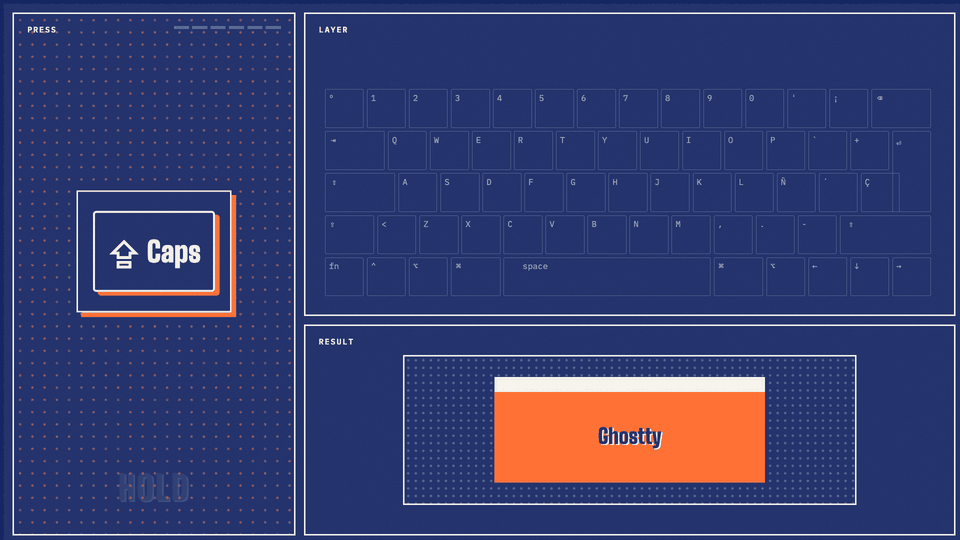

# keymap

One set of keys for every app on my Mac, on both Spanish ISO and US layouts.

## Layers

Four held keys each open a layer. Everything else on the keyboard behaves normally.

| Hold | Layer | What it does |
| --- | --- | --- |
| Caps Lock | apps and windows | One letter per app (W **W**eb browser, R te**R**minal, E **E**xplorer…), window halves and sizes, Space as Enter |
| Left ⌥ | numbers | A numpad under the right hand (U I O / J K L / M , .), Space as 0, plus delete char, word and line |
| Right ⌘ | arrows | J K L Ñ become ← ↓ ↑ → so the hands stay on the home row |
| Right ⌥ | Hyper (⌃⌥⇧⌘) | Tools: OCR, grammar fix, emoji, AI chat |

Right Shift is Escape.

## Same keys everywhere

J K L Ñ mean left, down, up, right wherever they appear: Vim's H J K L moved one key to the right, onto the home row. The scroll keys match too:

- **Windows** (Caps layer): J left half, Ñ right half, K larger, L smaller
- **Text** (Right ⌘ layer): arrows
- **Terminal** (tmux scroll mode) and **browser** (Vimium): U and D scroll, K and L page

## Built with

[Karabiner-Elements](https://karabiner-elements.pqrs.org) for the layers, [Raycast](https://www.raycast.com) for app and window hotkeys, tmux and [Vimium](https://vimium.github.io) for the terminal and browser. US layouts lose Ñ, so it moves to `;`, the key in the same position.

The configs live in a private dotfiles repo, set up on a new Mac by one re-runnable installer: Homebrew, runtimes through mise, symlinked dotfiles with backups, macOS defaults, and a private overlay for work settings. This repo is only the showcase.
